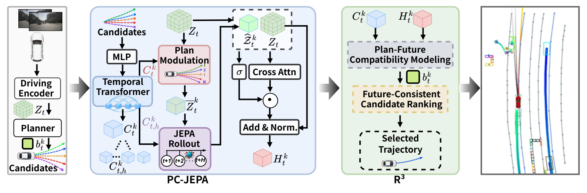
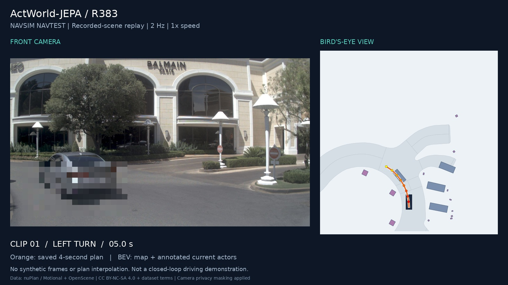
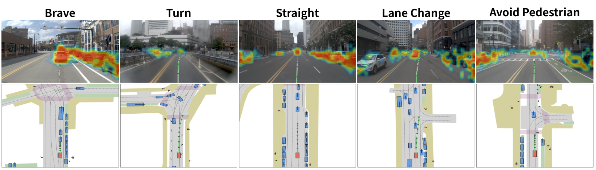
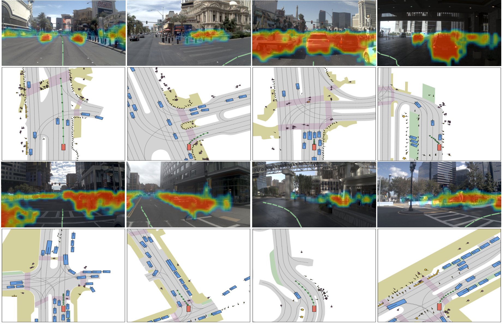
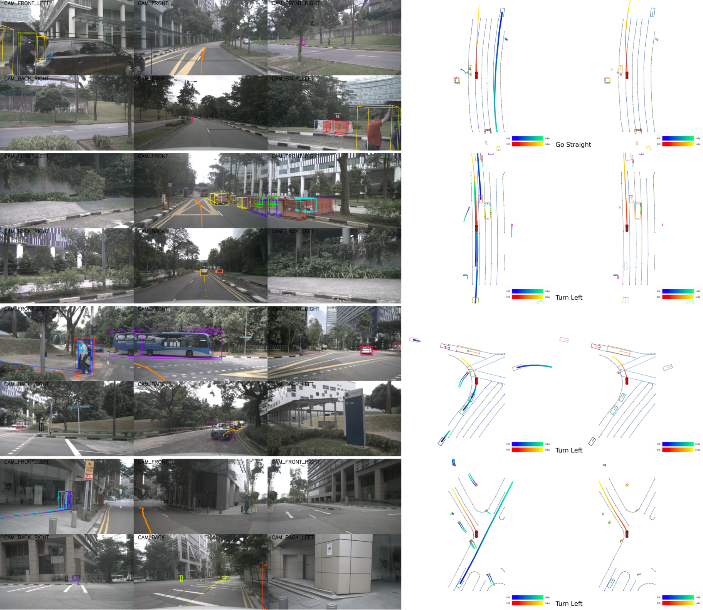

<div align="center">

# ActWorld-JEPA
### Action-Conditioned JEPA World Models Meet Latent Planning<br>for End-to-End Autonomous Driving

**Ziying Song · Shengkai Zhang · Caiyan Jia · Lei Yang · Lin Liu · Li Wang · Yadan Luo · Linhan Wang · Chen Lv**

[](https://adept-thu.github.io/ActWorld-JEPA/)
[](https://huggingface.co/shengkaizhang/ActWorld-JEPA)
[](LICENSE)

</div>

ActWorld-JEPA predicts action-conditioned future representations and uses them
to improve trajectory planning. **PC-JEPA** connects candidate plans to latent
future outcomes; **R³** performs relational residual reranking. The release
contains the frozen main deployments for NAVSIM v1, NAVSIM v2, and nuScenes.



## Contents

- [Results and checkpoints](#results-and-checkpoints)
- [Getting started](#getting-started)
- [Qualitative results](#qualitative-results)
- [Reproducibility and licensing](#reproducibility-and-licensing)

## Results and checkpoints

**Choose one benchmark row, download its weights, then follow its guide.**
NAVSIM v2 NAVTEST and NAVHARD share a neural checkpoint but use different
deployment steps. The learned selectors are required, not optional extras.

| Benchmark / split | Model | Metric | Result | Checkpoint and required artifacts | Reproduce |
|:--|:--|:--|--:|:--|:--|
| NAVSIM v1 NAVTEST | ActWorld-JEPA | Leaderboard PDMS ↑ | **90.07** | [Model bundle](https://huggingface.co/shengkaizhang/ActWorld-JEPA/resolve/main/actworld_jepa_navsim_v1_r383_bundle.tar.gz) (model + 4 selectors) | [v1 guide](docs/NAVSIM_V1_R383.md) |
| NAVSIM v2 NAVTEST | ActWorld-JEPA | EPDMS ↑ | **91.6** | [Model](https://huggingface.co/shengkaizhang/ActWorld-JEPA/resolve/main/actworld_navsim_v2.ckpt) + [3 selectors](docs/GETTING_STARTED.md#download-the-weights) | [v2 guide](navsim_v2/README.md#navtest) |
| NAVSIM v2 NAVHARD | ActWorld-JEPA | Combined EPDMS ↑ | **42.7** | [Same model](https://huggingface.co/shengkaizhang/ActWorld-JEPA/resolve/main/actworld_navsim_v2.ckpt) + [all 5 selectors](docs/GETTING_STARTED.md#download-the-weights) | [NAVHARD guide](navsim_v2/README.md#navhard) |

### nuScenes planning [Checkpoint](https://huggingface.co/shengkaizhang/ActWorld-JEPA/resolve/main/actworld_nuscenes_r13.pth) · [Configuration](nuscenes/projects/configs/actworld_nuscenes.py) · [Evaluation guide](nuscenes/README.md)

| Metric ↓ | 1 s | 2 s | 3 s | 4 s | 5 s | 6 s | Mean (1–6 s) |
|:--|--:|--:|--:|--:|--:|--:|--:|
| L2 (m) | 0.2780 | 0.5380 | 0.8851 | 1.3135 | 1.8181 | **2.3945** | **1.2045** |
| Box collision (%) | 0.012 | 0.136 | 0.344 | 0.723 | 1.334 | 2.034 | **0.7638** |

Results are evaluated on the corresponding benchmark splits using the released
configurations. See [evaluation details](docs/EVALUATION_PROTOCOLS.md) for the
NAVSIM v2 scoring implementation and nuScenes averaging convention.

## Getting started

This release is for **running the frozen main models**. You do not need to
retrain them. Use Linux, an NVIDIA GPU and Conda for the documented evaluation
workflows. Dataset downloads and metric-cache preparation are separate steps.

```bash
git clone https://github.com/adept-thu/ActWorld-JEPA.git
cd ActWorld-JEPA
```

1. **Choose your benchmark.** NAVSIM v1, NAVSIM v2 and nuScenes require separate
   environments. Do not install both NAVSIM packages in the same environment.
2. **Download the matching checkpoint and selectors.** Follow the
   [download instructions](docs/GETTING_STARTED.md#download-the-weights);
   verify SHA256 before loading files.
3. **Prepare data and maps.** Obtain the original datasets from their providers.
   NAVSIM also needs the matching split's metric cache and V-JEPA initialization.
4. **Install and evaluate.** Follow one of the guides below, replacing the
   example absolute paths with your own directories.
5. **Read the correct result.** Match the split, evaluator and averaging rule
   in [evaluation protocols](docs/EVALUATION_PROTOCOLS.md).

| I want to… | Follow this guide | Output |
|:--|:--|:--|
| Run NAVSIM v1 | [NAVSIM v1](docs/NAVSIM_V1_R383.md) | `submission.pkl`; local scoring is a separate command |
| Evaluate NAVSIM v2 NAVTEST | [NAVSIM v2](navsim_v2/README.md) | Timestamped evaluation CSV |
| Evaluate NAVSIM v2 NAVHARD | [NAVHARD](navsim_v2/README.md#navhard) | Final trajectories + two-stage score CSV |
| Evaluate nuScenes | [nuScenes](nuscenes/README.md) | Predictions + six-horizon planning metrics |

Start with [the beginner checklist and troubleshooting](docs/GETTING_STARTED.md).

## Qualitative results

### NAVSIM video demo

[](https://adept-thu.github.io/ActWorld-JEPA/#video)

**[Watch video](https://adept-thu.github.io/ActWorld-JEPA/#video)** ·
[Download MP4](https://adept-thu.github.io/ActWorld-JEPA/assets/navsim-r383-demo.mp4) ·
[Rendering instructions and provenance](docs/VISUALIZATION.md)

Three continuous turning clips, **31.5 seconds**, with recorded front camera
and saved R383 plans in BEV. This is an **offline replay**, not a closed-loop
driving demo. Source cadence is 2 Hz; no generated intermediate frames or
trajectory interpolation. BEV actors are dataset annotations. Media retain
the dataset's non-commercial/share-alike terms, separately from the code license.

### NAVSIM: scene understanding and planning



<details><summary>More NAVSIM examples</summary>


</details>

### nuScenes: six-second trajectories



## Reproducibility and licensing

- [Artifact manifest](artifact_manifest.json): exact file sizes and SHA256.
- [Verification record](docs/RELEASE_VERIFICATION.md): package checks and their limits.
- [Evaluation protocols](docs/EVALUATION_PROTOCOLS.md): splits, metrics and evaluation settings.
- [Third-party notices](THIRD_PARTY_NOTICES.md): original licenses remain in force.

Datasets, metric caches, credentials, optimizer states and private experiment
records are not distributed. Obtain data and pretrained dependencies under
their providers' terms. The root code license does not relicense dataset images
or upstream pretrained weights. Only load trusted, hash-verified pickle files.

## Acknowledgements

We build on [Drive-JEPA](https://github.com/linhanwang/Drive-JEPA),
[NAVSIM](https://github.com/autonomousvision/navsim),
[MomAD](https://github.com/adept-thu/MomAD),
[SparseDrive](https://github.com/swc-17/SparseDrive), and V-JEPA 2.
README organization is inspired by [DiffusionDrive](https://github.com/hustvl/DiffusionDrive);
project presentation is also inspired by MomAD and KineWorld.
Their videos and media are not copied into this release.

## Citation

See [CITATION.cff](CITATION.cff) for the manuscript's citation metadata.
