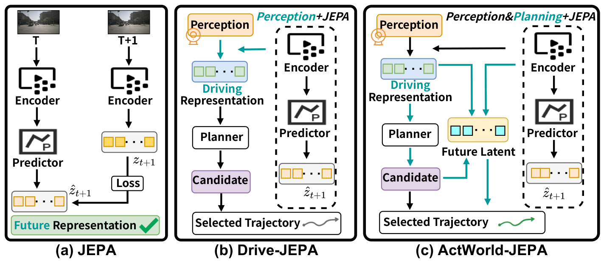

<div align="center">

# ActWorld-JEPA
### Action-Conditioned JEPA World Models Meet Latent Planning<br>for End-to-End Autonomous Driving

**Ziying Song · Shengkai Zhang · Caiyan Jia · Lei Yang · Lin Liu · Li Wang · Yadan Luo · Linhan Wang · Chen Lv**

[](https://adept-thu.github.io/ActWorld-JEPA/)
[](https://huggingface.co/shengkaizhang/ActWorld-JEPA)
[](LICENSE)

</div>

**ActWorld-JEPA uses candidate plans to predict latent futures and improve trajectory planning.**
It combines plan-conditioned JEPA (PC-JEPA) with relational residual reranking
(R³). The base planners are iPad for NAVSIM and MomAD for nuScenes.

[Overview](#overview) · [Video](#video-demo) · [Results & weights](#results-and-checkpoints) · [Get started](#getting-started) · [Visualizations](#qualitative-results)

## Overview

**Which future matters for the action we are about to take?** Instead of
predicting future representations independently of a plan, ActWorld-JEPA
conditions latent prediction on candidate trajectories and uses plan–future
compatibility to guide planning.




## Video demo

https://github.com/user-attachments/assets/d01f5e66-94f4-4d34-9f27-8b106f57d24e

Three NAVSIM turning clips with recorded front-camera images and saved model
plans. **Offline replay, not closed-loop driving.**
[Media details and rendering](docs/VISUALIZATION.md).

## Results and checkpoints

**Choose one benchmark row, download its weights, then follow its guide.**
NAVSIM v2 NAVTEST and NAVHARD share a neural checkpoint but use different
deployment steps. The learned selectors are required, not optional extras.

| Benchmark / split | Metric | Result | Weights | Guide |
|:--|:--|--:|:--|:--|
| NAVSIM v1 NAVTEST | Leaderboard PDMS ↑ | **90.07** | [Model bundle](https://huggingface.co/shengkaizhang/ActWorld-JEPA/resolve/main/actworld_jepa_navsim_v1_r383_bundle.tar.gz) (model + 4 selectors) | [v1 guide](docs/NAVSIM_V1_R383.md) |
| NAVSIM v2 NAVTEST | EPDMS ↑ | **91.6** | [Model](https://huggingface.co/shengkaizhang/ActWorld-JEPA/resolve/main/actworld_navsim_v2.ckpt) + [3 selectors](docs/GETTING_STARTED.md#download-the-weights) | [v2 guide](navsim_v2/README.md#navtest) |
| NAVSIM v2 NAVHARD | Combined EPDMS ↑ | **42.7** | [Same model](https://huggingface.co/shengkaizhang/ActWorld-JEPA/resolve/main/actworld_navsim_v2.ckpt) + [all 5 selectors](docs/GETTING_STARTED.md#download-the-weights) | [NAVHARD guide](navsim_v2/README.md#navhard) |

### nuScenes planning

[Checkpoint](https://huggingface.co/shengkaizhang/ActWorld-JEPA/resolve/main/actworld_nuscenes_r13.pth) · [Configuration](nuscenes/projects/configs/actworld_nuscenes.py) · [Evaluation guide](nuscenes/README.md)

| Metric ↓ | 1 s | 2 s | 3 s | 4 s | 5 s | 6 s | Mean (1–6 s) |
|:--|--:|--:|--:|--:|--:|--:|--:|
| L2 (m) | 0.2780 | 0.5380 | 0.8851 | 1.3135 | 1.8181 | **2.3945** | **1.2045** |
| Box collision (%) | 0.012 | 0.136 | 0.344 | 0.723 | 1.334 | 2.034 | **0.7638** |

Results are evaluated on the corresponding benchmark splits using the released
configurations. See [evaluation details](docs/EVALUATION_PROTOCOLS.md) for the
NAVSIM v2 scoring implementation and nuScenes averaging convention.

## Getting started

**Run the released models without retraining.** You need Linux, Conda, an NVIDIA
GPU, and the dataset for your chosen benchmark. Use a separate environment
for NAVSIM v1, NAVSIM v2, and nuScenes.

```bash
git clone https://github.com/adept-thu/ActWorld-JEPA.git
cd ActWorld-JEPA
```

1. **Install and prepare data:** open one guide below and follow its setup section.
2. **Download and verify weights:** use the matching block in the
   [download guide](docs/GETTING_STARTED.md#download-the-weights), from the repository root.
3. **Evaluate:** return to the benchmark directory, set your data/weight paths,
   and run the guide's evaluation command.

| Benchmark | Setup and evaluation | What you get |
|:--|:--|:--|
| NAVSIM v1 NAVTEST | [NAVSIM v1 guide](docs/NAVSIM_V1_R383.md) | Submission predictions; separate local scoring command |
| NAVSIM v2 NAVTEST | [NAVTEST guide](navsim_v2/README.md#setup) | Evaluation CSV |
| NAVSIM v2 NAVHARD | [NAVHARD guide](navsim_v2/README.md#navhard) | Final trajectories and two-stage score CSV |
| nuScenes | [nuScenes guide](nuscenes/README.md) | Predictions and 1–6 s planning metrics |

NAVSIM v2 NAVHARD uses its own two-stage data and cache, not the NAVTEST cache.
Download every selector required by your benchmark. See the
[checklist and troubleshooting](docs/GETTING_STARTED.md) if a dependency or path is missing.

## Qualitative results

### NAVSIM: scene understanding and planning


<details><summary>More NAVSIM examples</summary>


</details>

### nuScenes: six-second trajectories


## Reproduction notes

This release provides inference code, configurations and model artifacts.
It is not a complete from-scratch training recipe. Environment versions and
checks are documented in the benchmark guides; a clean GPU reproduction on
new hardware has not been independently validated.

[Evaluation protocols](docs/EVALUATION_PROTOCOLS.md) ·
[Artifact hashes](artifact_manifest.json) ·
[Release verification](docs/RELEASE_VERIFICATION.md)

## Acknowledgements and license

We thank iPad, Drive-JEPA, NAVSIM, MomAD, SparseDrive and V-JEPA 2.
See [third-party notices](THIRD_PARTY_NOTICES.md) for sources and licenses.
Code is released under [Apache-2.0](LICENSE); dataset images and upstream
artifacts retain their respective terms.

## Citation

See [CITATION.cff](CITATION.cff) for the manuscript's citation metadata.
